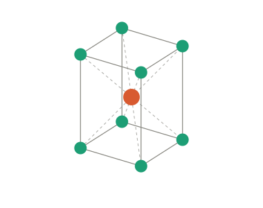
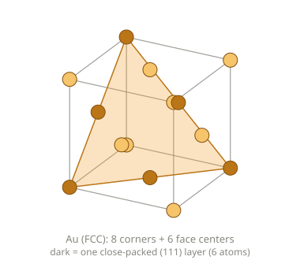
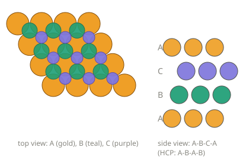

# 元素の呼吸：BCC↔FCC から、金の「息をする縁」まで

> 形が往復する。√2 と 1 のあいだを、条件に応じて行き来する。そこに「呼吸」を見る。
> 前作「元素の形」の続き。鉄の変態を起点に、他の元素の往復、そして金へ。

---

## 1. 事実：BCC↔FCC は「ちょっと歪ませる」だけで繋がる

### ベイン変形（Bain path）

FCC の立方体の中には、体心正方（BCT）の小さな箱が隠れている。底面は正方形で、**軸比 c/a = √2**。この箱を c 軸方向に縮め、直交する2方向に伸ばして c/a = 1 にすると、ぴったり BCC になる。回転は要らない。縮めて伸ばすだけで、面心にいた原子たちが体心の位置へ移る。

*（橙＝体心、緑＝角。体積をほぼ一定に保った簡略版。スライダーで動かせる版は [bain-path-interactive.html](bain-path-interactive.html)）*

実際の鉄の変態は、これに小さなずれ（せん断）が加わって進む。ここで見ているのは、変態の**幾何の骨格**。

### 鉄が往復する理由（事実）

| 温度 | 相 | 構造 |
|---|---|---|
| 〜912℃ | α-Fe | BCC |
| 912〜1394℃ | γ-Fe | FCC |
| 1394〜1538℃ | δ-Fe | BCC |

- 高温で BCC に**戻る**のは、BCC のほうが「ゆるい」ぶん、原子の振動で稼げるエントロピー（振動エントロピー）が大きいから、と説明される。低温側の α-Fe の安定には、強磁性も効いている。
- 充填率は FCC が約74%、BCC が約68%。**詰まっている側が常に安定、ではない**。条件で入れ替わる。
- 鋼を急冷すると、炭素が FCC の八面体の穴に閉じ込められたまま BCC 側へ変態し、BCC が歪んで BCT になる。これが焼き入れ鋼の硬さ（マルテンサイト）の元。

---

## 2. 事実：ほかの元素の「呼吸」。仕組みは3種類に分かれる

### ① 結晶が形を往復するもの（外の条件で往復）

| 元素・物質 | 往復 | 仕組みの軽い解説 |
|---|---|---|
| **チタン、ジルコニウム** | 約860〜880℃で六方最密 ⇄ 体心立方 | 鉄と同じ型。高温では振動エントロピーの稼げる BCC が有利になる。 |
| **コバルト** | 約420℃で六方最密 ⇄ 面心立方 | 積層が ABAB ⇄ ABC の違い。積層のずれにかかるエネルギーが小さく、積み方を切り替えやすい、と説明される。 |
| **スズ** | 13℃を境に、白色スズ（金属）⇄ 灰色スズ（ダイヤモンド型） | 結合の性質が金属的⇄共有結合的に入れ替わる。灰色側は体積が約27%増えるので、寒さで崩れて粉になる（スズペスト）。 |
| **プルトニウム** | 常圧で6つの形（体積も大きく変わる） | 5f 電子が「局在」と「非局在」の境目にいて、わずかな温度差で結合の様子が変わる。 |
| **ニッケルチタン（形状記憶合金）** | 低温の変形が、加熱で元に戻る | マルテンサイト変態。原子が拡散せず、協調してせん断的にずれる変態で、ベイン変形の仲間。 |
| **パラジウム** | 水素を吸うと格子が膨らみ、抜くと戻る | 水素原子が八面体の穴に入り込んで、格子を押し広げる。 |

### ② 原子や分子が内側で脈を打つもの（量子の準位）

| 対象 | 往復 | 仕組みの軽い解説 |
|---|---|---|
| **セシウム133** | 毎秒 9,192,631,770 回（1秒の定義） | 核スピンと電子スピンの向きの組み合わせで決まる、2つのエネルギー準位の間の遷移。原子時計の心拍。 |
| **アンモニア** | 毎秒約240億回（最初のメーザーの元） | 窒素が水素3個の作る面の上下にある2つの安定位置を、トンネル効果で往復する。傘が裏返る形。 |

### ③ 反応が自走して脈打つもの

| 対象 | 往復 | 仕組みの軽い解説 |
|---|---|---|
| **ベロウソフ・ジャボチンスキー反応** | 溶液の色が周期的に切り替わる | 自己触媒（生成物が反応を加速する）と、抑制のフィードバックが組み合わさって、濃度が振動する。セリウムの価数が変わるときに色が変わる。 |
| **鉄線と硝酸** | 溶ける⇄溶けない、をくり返す | 表面の保護膜（不動態）が、できては壊れる。20世紀初頭には、神経の興奮の伝わり方の模型に使われた。 |

---

## 3. 事実：金（Au）は、バルクでは呼吸せず、小ささと表面で呼吸する

### 金の形（イメージ）

金のバルクは **FCC（面心立方）**。立方体の8つの角と、6つの面の中心に1個ずつ原子がいる。下の図は、その単位格子がゆっくり回っているところ（原子は見やすいよう小さく描いてある。実際の原子はもっと大きく、隣と接している）。

濃い色の6個（立方体の3つの角と、3つの面の中心）を結ぶと、**正三角形の面**ができる。これが原子が最も詰まって並んだ層（(111)面）。この層を、少しずつずらしながら重ねたものが FCC。

上から見ると、A層（金）の原子の隙間に、B層（緑）と C層（紫）が交互に収まる。重ね方は A→B→C→A と3層で一巡する（六方最密 HCP なら A→B→A→B と2層で戻る）。**FCC の立方体の対角線方向から見ると、この ABC の積み重ねになっている**。

### 補足：バルクとは

**バルク（bulk）は「かたまり」のこと。** 指でつまめる金の延べ棒や指輪のように、原子が膨大な数（1 cm³ の金に約 6×10²² 個）並んだ、ふつうの大きさの金属を指す。

バルクでは、原子の大半が「まわりを全部原子に囲まれた内側」にいて、表面の原子は割合としてほとんど無視できる。粒を小さくしていくと、表面の原子の割合が増えていく（おおよその目安）：

| 粒の直径 | 表面にいる原子の割合 |
|---|---|
| 約3 nm | 約半分 |
| 約10 nm | 約15% |
| 約100 nm | 約1〜2% |
| バルク | ほぼ 0 |

表面の原子は隣が欠けているので、内側とはふるまいが違う。だから、バルクの性質は「内側の並び（FCC）」で決まり、ナノでは「表面の割合」が効いてくる。金が小さくなると赤く見えたり、融点が下がったりするのは、この割合の変化による。バルクとナノの境は、はっきりした線ではなく、性質ごとに違う（目安は数十〜100 nm あたり）。

### バルクの金は呼吸せず、小ささと表面で呼吸する

バルクの金は、融点（1064℃）まで FCC のまま一度も変わらない。静かな側の代表。ただし小さくしたり表面を見たりすると、いくつもの呼吸が現れる。

| 現象 | 内容 | 仕組みの軽い解説 |
|---|---|---|
| **ナノ粒子の呼吸モード** | 超短パルスレーザーで、粒子全体が膨らんで縮むのを繰り返す（ピコ秒スケール） | 急に熱せられて膨張した格子が、慣性で行き過ぎ、弾性で戻る、という弾性振動。周期は粒の大きさに比例。 |
| **局在表面プラズモン共鳴** | 光に反応して、表面の自由電子が集団で往復する。コロイド金の赤色の元 | 光の電場で電子の雲が粒に対してずれ、正電荷の格子が引き戻す。ばねのような集団振動。 |
| **ヘリンボーン再構成** | (111) 面の最表層が、中より約4%多く原子を詰め、FCC 領域と HCP 領域が縞状に並ぶ | 表面は引っ張り応力を抱えている。余分に詰めて逃がすと、積み方のズレる境界が縞になる。前に見た ABC と ABAB の違いが、空間的に並ぶ。 |
| **クラスターの準溶融と形** | 数 nm 以下の粒は、室温でも構造がふらふら入れ替わる。Au₂₀ は正四面体 | 表面の原子の割合が大きく、構造どうしのエネルギー差が小さい。Au₂₀ の四面体は FCC の一片の形でもある。 |
| **Au–Cd 合金** | 形状記憶効果が最初に見つかった合金のひとつ（1951年） | ニッケルチタンと同じ、マルテンサイト変態。 |

---

## 4. 試論：呼吸という形

ここから先は、1〜3 の事実の上に重ねた解釈である。

### √2 と 1 は、どちらが偉いわけではない

BCC↔FCC の変形で動くのは「c/a という比」だけで、原子の並びは連続的に繋がっている。√2（割り切れない比）と 1（割り切れた比）の間を、温度という条件で行き来する。しかも鉄は 1394℃で BCC に戻る。「1 に閉じたり √2 に開いたり」を繰り返す、往復の形をしている。

充填率は FCC が上、BCC が下だが、高温では BCC が有利になる。「√2 は未熟、1 は完成」ではなく、**条件によってどちらが安定かが入れ替わる**。ひとりの中にあって、精神の往復のひとつ、と読むこともできる。

### 呼吸には3種類ある

- **呼ばれて往復する**（①）：温度・圧力という外からの条件で形が切り替わる。
- **量子の準位で往復する**（②）：外から揺すられなくても、内側に決まった周期がある。
- **自走して往復する**（③）：フィードバックの構造が、脈を生む。

同じ鉄が①でも③でも出てくる。ひとつの元素が、複数の呼吸を持つ。

### 金は「静かな中心と、息をする縁」

バルクの金は動かない中心。呼吸は小ささと表面で起きる。鉄は中身そのものが呼吸し、金は縁が呼吸する。**静けさが中にあって、揺れが境界に出る**、という配置の形をしている。

バルクは「内側が主役」、ナノは「縁が主役」。粒を小さくすると、内側と縁の割合が入れ替わり、静かだった金が息をしはじめる。「静かな中心と息をする縁」は、この**内側と縁の割合が入れ替わる境目**を、言い直したものと見ることもできる。前に書いた「面の外の点」（観測者は平面の外にあり、境界で奥行きが開く）と、並べて眺めてみる価値がある。

---

## 5. 用語解説

| 用語 | 意味 |
|---|---|
| **バルク** | 原子が膨大な数並んだ「かたまり」の状態。性質は主に内側の並びで決まり、表面の影響は小さい。 |
| **ナノ粒子** | 直径が数〜100 nm 程度の粒。原子のうち表面にいる割合が大きく、バルクと性質が変わる。 |
| **ベイン変形** | FCC と BCC を、c/a を √2 から 1 へ連続的に変えて繋ぐ、変態の幾何の骨格。 |
| **BCT（体心正方）** | 底面が正方形で、高さ（c）が底辺（a）と違う箱。体心に原子がある。 |
| **軸比 c/a** | 箱の高さ c と底辺 a の比。 |
| **同素変態** | 同じ元素が、温度や圧力で結晶構造を変えること。 |
| **振動エントロピー** | 原子の振動の自由度に由来するエントロピー。ゆるい構造ほど大きく、高温ほど効く。 |
| **マルテンサイト変態** | 原子が拡散せず、協調してせん断的にずれて起こる変態。焼き入れ鋼や形状記憶合金の元。 |
| **準位** | 量子的な系がとれる、とびとびのエネルギーの値。 |
| **トンネル効果** | エネルギーの壁を、越えずに「すり抜ける」量子的な現象。 |
| **局在表面プラズモン** | 金属ナノ粒子の表面で、自由電子が集団で往復する振動。 |
| **呼吸モード** | ナノ粒子が全体として膨張と収縮をくり返す、弾性振動のモード。 |
| **再構成（表面）** | 表面の原子が、内側の並びとは違う並びに変わること。 |
| **不動態** | 金属の表面にできる、保護的な薄い膜。 |
| **準溶融** | 融点よりずっと低い温度で、小さな粒の構造がふらふら入れ替わる状態。 |
| **自己触媒** | 反応の生成物が、その反応自体を加速すること。 |

---

## この試論の限界を明示しておく

- ①②③は、結晶構造、量子準位、反応速度論という、まったく別の仕組み。「呼吸」という共通の形は、見立ての層の話であり、同じ原理から生じたことを意味しない。
- アニメーションは、体積をほぼ一定に保った簡略版で、実際の鉄の変態そのものではない。実際の経路には、せん断や、結晶粒界での核生成などが関わる。
- 「√2 ＝ 割り切れなさ、1 ＝ 自分でこなす」は、意識への比喩であって、数学や物理が要求する結論ではない。√2 と 1 が、どちらも「自分」のどこかに対応する、というのも見立て。
- 表面原子の割合の表は、球形の粒を仮定したおおよその目安。バルクとナノの境は性質ごとに違い、一本の線は引けない。
- 「静かな中心と息をする縁」は、金の4つの現象（弾性振動、電子の集団運動、表面の応力、クラスターのエネルギー地形）を、配置の相似で束ねたもの。仕組みはバラバラ。
- 「面の外の点」との接続は、構造的な相似の指摘にとどまり、数学的な同一性の主張ではない。
