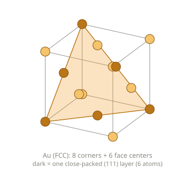
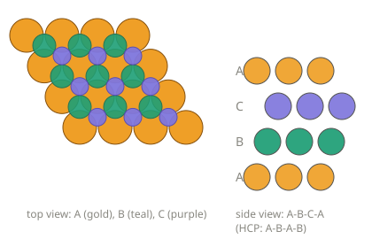

# 金の3と5：きれいに閉じる3と、閉じきらない5

> 金の結晶には、3回で一巡する形（ABC積層）と、5つの四面体が囲む形（十面体）がある。
> 3はきれいに閉じ、5は7.4°のすきまを残す。そのすきまを、結晶は歪みで閉じる。
>
> 関連ファイル：[au-fcc-cell.svg](au-fcc-cell.svg)、[au-stacking-abc.svg](au-stacking-abc.svg)、[five-tetrahedra-gap.html](five-tetrahedra-gap.html)

---

## 1. 事実：金（FCC）の「3」

### 見る向きで形が変わる

金のバルクは FCC（面心立方）。立方体の8つの角と6つの面の中心に原子がいる。

同じ結晶でも、見る向きで見え方が変わる。

| 見る向き | 見える形 |
|---|---|
| [100]（立方体の面の方向） | 正方形の並び |
| [110] | 長方形の並び |
| [111]（立方体の対角線の方向） | 三角形に並んだ層（六角形に見える） |

### ABC 積層

[111] 方向に見ると、原子が最も詰まった層（(111)面）が、少しずつずれながら重なっている。ずれ方は A→B→C→A の3層で一巡する。

- 立方体は、対角線（[111]）のまわりに 120° 回すと、自分に重なる（3回回転対称）。
- 「ずらして重ねる」と「回して重ねる」が、どちらも3という数で噛み合っている。
- 六方最密（HCP）は A→B→A→B の2層で戻る。FCC は3層。

### 逆向きに積むと、双子になる

…ABCABC… の途中で、…CBA… と積み方の向きが反転すると、その境目が**双晶面**になる。両側は同じ FCC の結晶で、境目に対して鏡のように向きが反転している。金は、この双晶ができやすい金属のひとつ。

---

## 2. 事実：5つの四面体の「5」

### 四面体は、空間を埋め尽くせない

正四面体の**二面角**（2つの面が辺で作る角）は、

$$\arccos\tfrac{1}{3} \approx 70.53^\circ$$

1本の辺のまわりに、正四面体を5個並べると、

$$5 \times 70.53^\circ \approx 352.64^\circ$$

で、一周（360°）に**約7.36°足りない**。すきまが残る。正四面体だけでは、空間を隙間なく埋められない。

### 金の十面体（デカヘドロン）

金のナノ粒子には、5つの四面体が1本の辺を囲んでできた**十面体**（五角両錐）の形がある。

- 5つの部分は、それぞれ FCC の結晶。境目の5枚の面は、双晶面。
- すきま 7.36° は、結晶が全体で少し**歪む**ことで閉じている。1個ぶんの角を 70.53° から 72° に広げれば、5つがぴったり噛み合う。必要な角度の歪みは約2.1%。
- 歪みのエネルギーは、粒が大きいほど溜まる。だから十面体は、小さな粒（数 nm〜数十 nm）で現れやすい。
- 銀や金のナノワイヤーに、五角形の断面のものがあるのも、同じ仕組み。

> 試してみる：[five-tetrahedra-gap.html](five-tetrahedra-gap.html) の「歪み」スライダーを動かして、すきまが閉じるのを見る。

### 5回対称は、単一の結晶には作れない

周期的に並んだ結晶は、回転対称として 1・2・3・4・6回しか持てない（**結晶学的制限**）。5回はない。理由を短く言うと、格子の回転を格子の基準ベクトルで書くと、行列の成分が整数になる。すると 2cosθ が整数になる必要があり、θ は 60°・90°・120°・180°・360° に限られる。72°（5回）は 2cos72° ≈ 0.618 で、整数ではない。

十面体が5回対称に見えるのは、**5つの結晶の寄せ集め**だから成り立つ。周期性を手放して5回対称を持つ別の物質に、**準結晶**がある（2011年ノーベル化学賞）。

---

## 3. 試論：閉じる3と、閉じきらない5

ここから先は、1・2の事実の上に重ねた解釈である。

### 3は閉じ、5は閉じきらない

- ABC 積層は、3回ずらすと**ぴったり元に戻る**。
- 5つの四面体は、5回並べても**7.36°足りない**。そのすきまを、結晶が歪みとして抱えこんで、形を閉じる。

同じ金が、きれいに閉じる3と、ずれを残す5を、両方持っている。しかも5のほうは、**ずれをためこむことで形になっている**、と見ることもできる。

### 四面体の階段

前に見た、水・鉄・金の四面体の並びに、5を足してみる。

| 対象 | 四面体の現れ方 |
|---|---|
| 水 | 1個で閉じる（酸素のまわりの電子対4組） |
| 鉄（BCC） | 向きの違う2個が重なって立方体の骨格を作る |
| 金（FCC） | 四面体と八面体が隙間として織り込まれる |
| 金（十面体） | 5個が1本の辺を囲み、すきまを歪みで閉じる |

「閉じる」「重なる」「隙間に抱える」「ずれを抱えて閉じる」と、四面体の付き合い方が段階的に変わっているように見える。

### 見る向きで形が変わる

同じ立方体が、向きによって、四角にも、長方形にも、三角の層にも見える。形は、対象の側だけでなく、**どこから見るか**とセットで決まる。

---

## 4. 用語解説

| 用語 | 意味 |
|---|---|
| **[111]** | 立方体の対角線の方向。この方向に垂直な面が (111) 面。 |
| **(111)面** | FCC で原子が最も詰まった面。三角形に原子が並ぶ。 |
| **最密層** | 原子が最も隙間なく並んだ層。 |
| **ABC 積層** | 最密層を、A→B→C→A と3層で一巡するようにずらして重ねた並び。FCC の積み方。 |
| **回転対称（n回）** | 360°/n 回すと、自分に重なる性質。 |
| **二面角** | 2つの面が、1本の辺で作る角。 |
| **双晶／双晶面** | 結晶が鏡のように向きを反転して接した状態／その境目の面。 |
| **十面体（デカヘドロン）** | 5つの四面体が1本の辺を囲んでできた、五角形の断面を持つ粒の形。 |
| **歪み** | 結晶がもとの形からずれて、弾性エネルギーが溜まっている状態。 |
| **結晶学的制限** | 周期的な結晶が持てる回転対称は、1・2・3・4・6回に限られるという定理。 |
| **準結晶** | 周期性を持たないのに、5回対称などを持つ、規則的な並びの物質。 |

---

## この試論の限界を明示しておく

- 3（ABC 積層）は結晶の**内部の並び**、5（十面体）は粒の**外形と双晶の構造**の話。同じ「金の形」でも、見ている層が違う。
- 7.36° のすきまと 2.1% の歪みは、正四面体と角度だけに注目した単純な目安。実際の十面体では、歪みは角度だけでなく原子間の距離の変化にも分散し、表面の形も（Ino 十面体、Marks 十面体など）修正される。
- 十面体が金で多く見られるのは、金の表面エネルギーなど、別の要因も絡んでいる。「5だから金」とは言えない。
- 「ずれをためこんで形になる」「3は閉じ、5は閉じきらない」は、構造の相似と見立てであって、意識や自己の話を要求するものではない。
（ということに、まだしておきましょう。(*´ω｀)）
- 「四面体の階段」は、水・鉄・金という、結合の仕組みが別物の対象を、形の相似で並べたもの。
