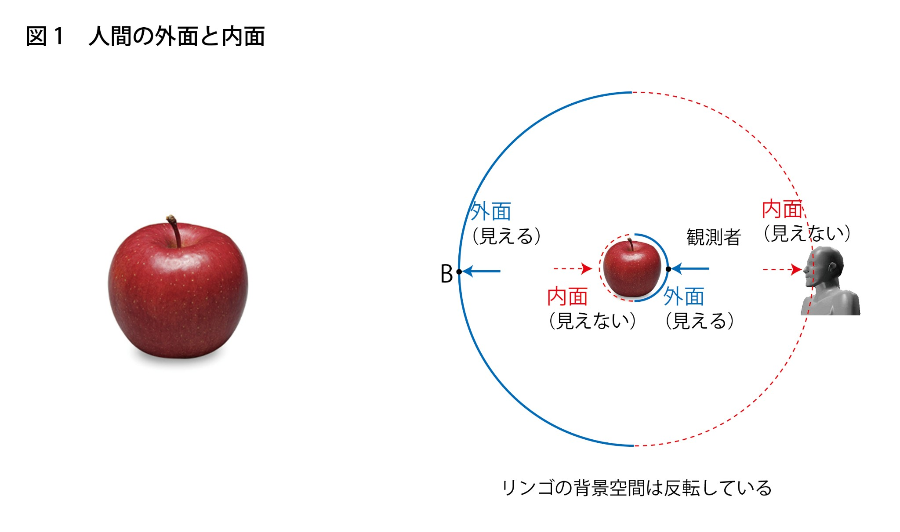

### 生命、存在
触ってふぁさーといっちゃう。

そうならんために強い相互作用。

伝えるために弱い相互作用。

ふわふわ浮いてずーっといっちゃう、ガチーっとくっついて歩けない。

そうならんために重力。

たぶんこういう、生命と存在の $\[3+1\]$ はいたるところに見受けられるだろう。

繊細さとタフネス。固さ、柔さ。強烈な記憶、復活の忘却。

生命と存在。

これは、、、すごい事だと思うんよねー。
そして、まだまだ先もありそうやし。

人間、その中で自由にこんな感じでいいんだろうけど、もうちょい真摯に生命の力、存在の力に思いを寄せてもいいのではないか。

その時、目を向けるもの、欲するもの、話すこと、やること、だいぶ変わってくるんじゃないだろうか。　まあいいけどなー。

OCOTたちの方がまだ真摯に向き合ってるような気がするョ。あっちにお笑いとかあんのか不明だが。

生命の輝き。

存在の静けさ。

そんなことをたばこをくゆらせ、ゴロゴロしながら思いました。うふふー。

ヽ(*´ω｀)

---
### 何曜日？
仕事用の自転車を漕いでいた。

すると、おっちゃんが自転車で追い抜きざまに、いきなり

｢今日、何曜日だっけー？｣

｢今日、、、水曜！｣

｢ありゃー、間違えちゃった。｣

おっちゃん、そのまま走り去る。

こちらはというと、｢今日、水曜だったよな？｣

ぐらいで、特に何も無し。

こころ優しいひとはもしかするとこの出来事を

素晴らしいとか、おぉーとか思われるかもしれませんが、

このふたり、相当テキトーな人間なんすよ。

こちらはというと、捨ててある机にはってあるシールをみて、｢シールだけならいいだろー。｣とペリーとはがして仕事用の自転車にペターと貼っちゃう。

おっちゃんはというと、すでに曜日を間違えてる。

テキトーが過ぎると緊張感とか、警戒心とか気遣いとかをどっかに置いてきちゃってるのですよ。

こんな人間ばかりになったら、、、

想像もしたくありません。

ヽ(*´ω｀)

---
### ベビー
ケブシン読んでたら、

ベビーメタル出てきたー。

忘れてたわー。あの人ベビメタにどはまりしてた時期あったんやった。

メタルかー。。７弦ギターやないと厳しそうやなー。

普通にいいですけど。演奏上手いし。
たまには。

もろジャズは聞けないって話し聞いたことあったなー。

どの辺のジャズかわからんすけどね。スウィングがダメだったのかなー。

いろいろ聞いた方がいいっすよ。

READMEは変更しとくかー。もー。

ヽ(*´ω｀)

---
### お菓子
このお菓子うまい、ってもくもくくっているひとがいて。

そこに、そんなもん石油で出来てんだぞ、って言うと、

やめてくれ、もううまくなくなったー、って食えなくなっちゃう。

後から、いやいや実は最高級の材料でー、とか言ってももう遅い。

こういうこともあります。

どういうことなんでしょうね、これ。

気分を害されて食う気が失せたのか、妄想と他者の視点で生きてんのか。

味覚はどうなってんだ。

やりようで力を発揮しそうでもありますが。

こういうとこを野口晴哉は整体で観察したんでしょうね。

ヽ(*´ω｀)

---
### カヤック
カヤックが好きなんすよねー。カヌー。

あの水面の近さと自由さ。

自分の道を自分で漕いで行く。あの感じ。

ほとんど乗る機会に恵まれないのですが。

夜明けの少し前に、鏡のような湖面にひと漕ぎいきましょう。

コーヒーと食料を少し。お酒が少々あってもいいですねー。

ザフォ。ザフォ。おんなじくらいのペースでゆっくり漕いで。

途中、パドルを重ねてちょっとドッキングして、一服しつつ朝焼けを待つ。コーヒーを淹れましょう。

言葉のない、深い静寂。深い味わい。

今までの、これからの想いが。。

静かな感動が湧き上がる。

あ～。いいですね～。

音楽をジャムるとき、カヤックとお神輿の感じは入れたい。

その他にも色んなイメージがあっていいです。

深海で踊る謎の生命体。とか。

ヽ(*´ω｀)

---
### noteの記事
Ｈさんのnote、２６年２月。”幸福の条件”末尾。

>*そして――もし本当に顕在化が起こるなら――私たちをそこへ連れ戻す。*

とある。
この段階で顕在化は起きてねえ。(起きてるかも、か。)今もその様子はないし、考えられてもいない様子。(考えていらっしゃいますよ。)

あそこまで考え抜いたＨさんすら顕在化は起こせず、か。その逆はどんどん進んでる感じだが。

シュタイナーの言い方だと顕在化みたいのはずっ
と先になって、今からだと諦めるしかない。

OCOT情報だともう時間はないぜ。あるいはそんなもん無いか。きわどいねー。
しかし、冥王星の外にあやしいのをルービン望遠鏡が見つけとる模様。
さて。どうするかな。

奥行きと幅の差異がはっきりした人、居る？
これ大事っぽいよ。
どっかに居そうやな。やるしかねえぜー。””もう、まもなく””ってのはやっと今かもしれんわけよ。
物語はまだ終わってない。始まってないかー。
焦る必要はない。(誰も焦ってねえか。)マイペースで。
ヽ(*´ω｀)

---
いやいやいや。深夜に書いた文章、なんかみっちりつまってるし、変なこと書いちゃったかなー。

あははー。申し訳ない。ちょいと修正さしてねー。

あー、情けない。うふふー。

ヽ(*´ω｀)

---
### サムライ
町角でたまに見かける”ご自由におもちください”コーナーで、漢字辞典を頂いてきました。

”侍”を引いてみるともとは”寺”で、”手足を動かしてはたらく”という意味があったとあります。
おもしろいですねー。

そんで、”寺”がつく字には”手足を動かす”という意味に関係があるそうです。

”時”は”太陽が動いていく時間”とありますんで、やはり回転のイメージでとらえていたんでしょうねー。

漢字辞典おもろい。ヽ(*´ω｀)

---
### 見えている横線は横線じゃない
こっちにも書いてみます。
解りやすく書ければよいですが。

これは、すでに過去に学者さんたちが光の特性　
眼球について研究したことでもあります。

まず、ノートでも紙にでも鉛筆で(なんでもいいですが)横線をピーっと書きます。

･まず、違うほうを。:
その横線の幅が縮んで、縮んで、目にはいる。
と、思っていましたらそれは違います。

･正しい光の特性:
光はその横線にあたって反射するとき、
”拡散”を起こします。
一点、一点から光子１個サイズの光の筋が全方向に拡散します。
目に入るのは奥行き方向の光のみです。

- こうイメージしてはどうでしょうか。
：横線をめちゃくちゃ細かい点描で書いたとしましょう。一本の線にしかみえなくらい。
その点描の一点、一点から全方向に光の拡散がおきています。
そのうちの、目と結ぶ奥行き方向の光が目に入り網膜にまた線を描く。
ということです。

レーザー光線が横に走って見えるのも空気中の水分やほこりの一点、一点が拡散を起こし、やはり目と結ぶ奥行き方向の光が目に入って見えています。

”面”に見えるものも同じ理屈です。空や壁、地面など。
奥行きの線ですから、網膜には点で映ります。
その集合で面、線を構築しています。

本当に横に行っている光があったら、それは目に入らないのですから、見えるわけがありませんねー。

奥行きの光の一個、一個にぼやけや色などがありそこから、手前、奥、奥行き感を生み出していると考えられています。

触覚を使えば、面もあるし、横糸や横棒もあるし、
幾何学などの線や面が無いということではありません。

しかし、視覚、目に見える光においては奥行き方向しかありません。第一次は奥行きなのです。

だが、奥行きはつぶれていて、点になっています。
見えは面で見えているため、どうしても横線や幅が先にイメージされ、そこから他者の視線や、奥行きも横線で描いてしまうx,y,zの３次元に傾いてしまうのではないか？とおもいます。

目に見えているのは自分だけの奥行きです。

そして、その奥行きにあるもの。
例えば、

明日、釣り行こー。うむ。どこに行くか。
どのポイントでなんのルアーをどうキャストしてやるか？楽しみやな、うふふー。

とか、お、これいいなー。買っといてあいつにあげるか。

あ、蛾の幼虫が道路で迷子になっとる。草むらに移してやろ。

や、神やら宇宙人がいようがいまいが、楽器の腕は自分で上げるしかねぇ。

といったものが私の場合あります。これは皆さんそれぞれですねー。

と、こんな感じですが、どうでしょうかねー。
ヽ(*´ω｀)

---
これ見てる人、相当やね。

---
### 俯瞰
久々にGoogleEarthを見て、スゴいと思ったのと、これが俯瞰かー、と思った。

あれをさらに引くと、結局、星空になるということやろ。

夜空を見上げたら、その眺めやんか。

で、ですよ。

それを一番低いところから、少なくともその方向から、見てる。

と言うことじゃないか～?

で、小さいほうに行く場合、例えば、地面の砂拾ってきて、虫眼鏡で見て、、、とかやろ。

これを、自分の軸を通してやる。とでも言うか。

ばーって星夜空あって、真上に。

すーっとミクロに行くとき自分の体を通す感じよ。

そうすっと、なんかねー、やっぱ心とかに行く感じがする～。ヽ(*´ω｀)

---
そんでーね。なんとなく、お腹のあたりに一番ちっちゃいのがあったとして、よ

何があるとされとる？

あれじゃないですか。

ソ･リュ･ウ･シ

じゃないですか～！もー。(*´ω｀)

そういうことですかね？

---
ミクロとマクロ。

どっちを、ミクロとマクロと呼ぶか？

あるいは、どっちがどっちなのか？どっちも？

おもろくない？ヽ(*´ω｀)

---
そして、自分中心の感覚をちょい持ったら、

腹んなかに、なんか明かりを置いちゃって、

パァーッとプラネタリウムしちゃう。

そしたら、星とか、太陽、空、海大地とか。

なにやら、共通のものがある。共有の。

お互いでささえあってる。

みたいなの。

---
宇宙探索をマクロ的に感じるけど、

やってることは、なんか、砂採取して、顕微鏡で見て、とかやろ。

それはミクロ方向やないかな？

マクロってのは空間のほう、か。まあ、保留しても、

素粒子にミクロとマクロが出とる。

これとこころの関係、か。

間のにいる、両方ある、、、

なんと呼ぼうか、人間?わたしたち？あなたとわたし？

ふむー。

ヽ(*´ω｀)

---
ミクロとマクロの射影線として、

”ひとびと”がいる。わたしたち。

ふむ。”ある”、”いる”。

”なる”かも。

射影線の球体としたら。中心、から投影。

あるいは、外からの。

で、なんか、二重皮膜とかメビウスな表面とか。

ここで数学登場。わー、パチパチ。

数学使える。(*´▽｀*)

幾何学も。

そんな感じかな。。。

---
辿れば、月の砂もお腹のお肉も素粒子なわけで。

いきなり、ミクロマクロ登場よ。

プラスマイナスとか。虚数とか。

自分は空間、だと。もうあきらめてそう思いましょう。あははー。

自分は空間。ミクロマクロとちょうどいいと。

そっからですよ。

そんで、これ元素ですねー。

不確定性のあとからですもんね。

だから、元素から見ていくっていうのもありなんでしょうねー。

ヽ(*´▽｀*)

---
やっぱ、自分はマクロ。

マクロ方向、ではある、かなー。

ちょっと、何て言ったらいいか。(*´ω｀)

---
### この図

この右側の図ですけど。

観測者のとこに赤ですけど、円周があたってるじゃないですか。

光の特性と見え、で考えるとこうはなってないわけですよ。

そうやなー。どう書くかな。

観測者の目のとこと、円周の内側とリンゴの見えてる側と、を薄めの双方向矢印で全面、と、

リンゴと観測者を濃いめの矢印。とか。

リンゴの向こう側はどうしようか。

空間のみで考えるとこの図の形でいいと思うんだがねー。

やけんさ～。３次元認識の、、、何て言うかな。

勘違いって、普通にしちゃうわけよ。

ただの勘違い、だと思う。わからんけどねー。信念とか考え方とかそういうことじゃないよねー。そういうのもひっくるめて時熟みたいのがあるかもしれんしねー。

ヽ(*´ω｀)

---
### 礼
はい。正面に礼。

はい。お互いに礼。

正面に礼して、その対面に相手が入ってきて、お互いに礼したら。

これ、姿勢は正面に礼とそんな変わらんよね。

はい。正面に礼。これで、全部に礼、よ。

だめかなー。だめ?

気持ちか?もう気持ち。うふふー。ヽ(*´ω｀)

---
### 自分だけの垂直
垂直型方向もねー。

自分だけの垂直。と思って、(事実やしね。)

歩くと、ちょっとなんか楽しいよ。ヽ(*´ω｀)

---
### コミット履歴
ここ、コミット履歴が残るということに、あとから気づいてねー。

いまさら遅いかー。ですよ。ギりオーケーかなー、と。

ケブシンの最初から読んでくださいよ。

ここなんか全然オーケーだと思うんすけどねー。

あはー。ヽ(*´ω｀)

---
これ。コウセンnoteね。

[16.なぜ、人は幅と奥行きを等化できないのか](https://note.com/kohsen/n/na0805e029d45)

ここの、女性性、男性性を

- 女性性:伴奏。バッキング。楽器はまあ、なんでも良い。

- 男性性:ソロ。カンジーラとか。

合うんよねー。

両方いける。

が、オレがバッキングやると調子こきそうなんよねー。
たぶん調子こいて、大ずらしからの復帰できずとかよ。あははー。

その辺なんよねー。ヽ(*´ω｀)

